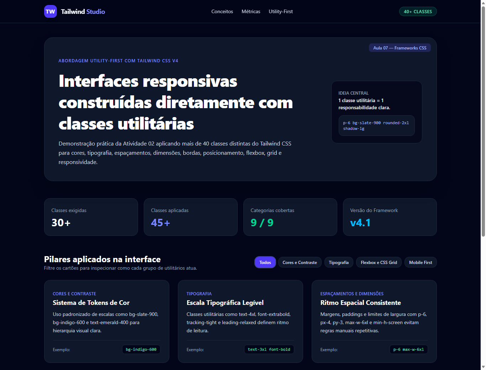

# 🌊 Tailwind UI Studio — Projeto Prático com Tailwind CSS v4

Projeto desenvolvido com **React**, **Vite** e **Tailwind CSS v4** para atender integralmente à **Atividade 02 da Aula 07 (Frameworks CSS)** da disciplina de **Frameworks Front-end** (SENAI).

---

## 📸 Captura de Tela da Aplicação em Funcionamento



---

## 🎯 Requisitos Atendidos (Aula 07 — Atividade 02)

1. Aplicação utilizando **pelo menos 30 classes diferentes do Tailwind CSS** (foram aplicadas **45 classes distintas** documentadas abaixo);
2. Cobertura integral das **9 categorias solicitadas**: cores, tipografia, espaçamentos, dimensões, bordas, posicionamento, flexbox, grid e responsividade;
3. Documentação em Markdown contendo captura real da aplicação, trechos do código-fonte, lista completa das classes utilizadas com suas respectivas funções e instruções de execução.

---

## 🛠️ Tecnologias Utilizadas

- React 19
- Vite 7
- Tailwind CSS v4 (`@tailwindcss/vite`)
- JavaScript (ES Modules)

---

## 📁 Estrutura de Diretórios

```text
projeto-tailwind-css/
├── docs/
│   └── screenshot-tailwind.png
├── src/
│   ├── App.jsx             # Interface Utility-First com filtro interativo
│   ├── index.css           # Importação oficial @import "tailwindcss";
│   └── main.jsx
├── .gitignore
├── index.html
├── package.json
├── vercel.json
├── vite.config.js
└── README.md
```

---

## 📋 Lista das Classes Tailwind CSS Utilizadas e Suas Funções

| # | Classe Tailwind | Categoria | Função na Interface |
|---|---|---|---|
| 01 | `bg-slate-950` | Cores | Define cor de fundo principal escura da página |
| 02 | `bg-slate-900` | Cores | Define cor de fundo dos cartões e seções |
| 03 | `bg-indigo-600` | Cores | Define cor de destaque primária em botões e ícones |
| 04 | `bg-emerald-500/15` | Cores | Define fundo verde translúcido (15% de opacidade) no selo |
| 05 | `text-slate-100` | Cores | Define cor clara principal do texto |
| 06 | `text-slate-300` | Cores | Define cor secundária suave para parágrafos |
| 07 | `text-indigo-400` | Cores | Destaca subtítulos e números com tom índigo |
| 08 | `text-emerald-300` | Cores | Destaca indicadores e trechos de código em verde |
| 09 | `text-xs` | Tipografia | Define fonte extra pequena (`0.75rem`) para etiquetas |
| 10 | `text-sm` | Tipografia | Define fonte pequena (`0.875rem`) para descrições |
| 11 | `text-2xl` | Tipografia | Define tamanho de título de seção (`1.5rem`) |
| 12 | `text-3xl` | Tipografia | Define tamanho de destaque para métricas e título mobile |
| 13 | `font-semibold` | Tipografia | Aplica peso tipográfico seminegrito (`600`) |
| 14 | `font-bold` | Tipografia | Aplica peso tipográfico negrito (`700`) |
| 15 | `font-extrabold` | Tipografia | Aplica peso tipográfico extranegrito (`800`) no Hero |
| 16 | `uppercase` | Tipografia | Transforma texto de categorias em letras maiúsculas |
| 17 | `tracking-tight` | Tipografia | Reduz espaçamento entre letras em títulos grandes |
| 18 | `leading-relaxed` | Tipografia | Aumenta altura de linha para facilitar leitura de textos |
| 19 | `p-6` | Espaçamentos | Aplica `padding` uniforme de `1.5rem` nos cartões |
| 20 | `px-4` | Espaçamentos | Aplica `padding` horizontal de `1rem` no container |
| 21 | `py-10` | Espaçamentos | Aplica `padding` vertical de `2.5rem` no conteúdo principal |
| 22 | `mx-auto` | Espaçamentos | Centraliza horizontalmente o container principal |
| 23 | `mt-4` | Espaçamentos | Adiciona margem superior de `1rem` |
| 24 | `space-y-12` | Espaçamentos | Cria espaçamento vertical consistente entre seções filhas |
| 25 | `min-h-screen` | Dimensões | Garante altura mínima de 100% da janela (`100vh`) |
| 26 | `w-full` | Dimensões | Define largura de `100%` do elemento pai |
| 27 | `max-w-6xl` | Dimensões | Limita a largura máxima do layout a `72rem` (`1152px`) |
| 28 | `h-16` | Dimensões | Define altura fixa de `4rem` (`64px`) na barra superior |
| 29 | `w-9` / `h-9` | Dimensões | Define largura e altura de `2.25rem` no ícone da marca |
| 30 | `border` | Bordas | Adiciona borda de `1px` nos cartões e selos |
| 31 | `border-b` | Bordas | Adiciona borda inferior no cabeçalho |
| 32 | `border-slate-800` | Bordas | Define cor sutil de borda para os painéis escuros |
| 33 | `rounded-xl` | Bordas | Aplica cantos arredondados médios em botões |
| 34 | `rounded-2xl` | Bordas | Aplica cantos arredondados amplos nos cartões |
| 35 | `rounded-full` | Bordas | Cria formato de pílula completa no badge superior |
| 36 | `ring-2` | Bordas | Adiciona anel de contorno no filtro selecionado |
| 37 | `sticky` | Posicionamento | Mantém o cabeçalho fixo ao rolar a página |
| 38 | `top-0` | Posicionamento | Posiciona o elemento `sticky` no topo da viewport |
| 39 | `z-50` | Posicionamento | Garante sobreposição do cabeçalho sobre o conteúdo |
| 40 | `relative` / `absolute` | Posicionamento | Posiciona o selo da Aula 07 no canto superior do Hero |
| 41 | `flex` / `flex-col` | Flexbox | Ativa Flexbox e empilha elementos verticalmente |
| 42 | `items-center` / `justify-between` | Flexbox | Alinha verticalmente ao centro e separa extremidades |
| 43 | `grid` / `grid-cols-1` / `gap-6` | Grid | Cria grade CSS de 1 coluna no mobile com espaçamento |
| 44 | `sm:px-6` / `sm:grid-cols-2` | Responsividade | Ajusta espaçamento e cria 2 colunas a partir de `640px` |
| 45 | `md:flex-row` / `md:grid-cols-2` / `lg:grid-cols-3` / `lg:text-5xl` | Responsividade | Adapta direção flex, colunas de grade e tipografia em tablets e desktops |

---

## 💻 Trechos Principais do Código

Importação do Tailwind CSS v4 (`src/index.css`):

```css
@import "tailwindcss";
```

Composição Utility-First nos cartões responsivos (`src/App.jsx`):

```jsx
<div className="grid grid-cols-1 md:grid-cols-2 lg:grid-cols-3 gap-6">
  {itensVisiveis.map((modulo) => (
    <article
      key={modulo.id}
      className="bg-slate-900 border border-slate-800 rounded-2xl p-6 flex flex-col justify-between gap-4 hover:border-indigo-500/60 transition-colors"
    >
      <span className="text-xs font-semibold text-indigo-400 uppercase tracking-wide">
        {modulo.categoria}
      </span>
      <h3 className="text-lg font-bold text-white">{modulo.titulo}</h3>
      <p className="text-sm text-slate-300 leading-relaxed">{modulo.descricao}</p>
    </article>
  ))}
</div>
```

---

## 🚀 Instruções de Instalação e Execução

```bash
git clone https://github.com/Enzootomas/projeto-tailwind-css.git
cd projeto-tailwind-css
npm install
npm run dev
```

Para gerar o build otimizado de produção:

```bash
npm run build
```

---

## 🎓 Disciplina

**Frameworks Front-end** — Curso Superior de Tecnologia em Análise e Desenvolvimento de Sistemas (SENAI)  
**Professor:** Me. Deivison S. Takatu
